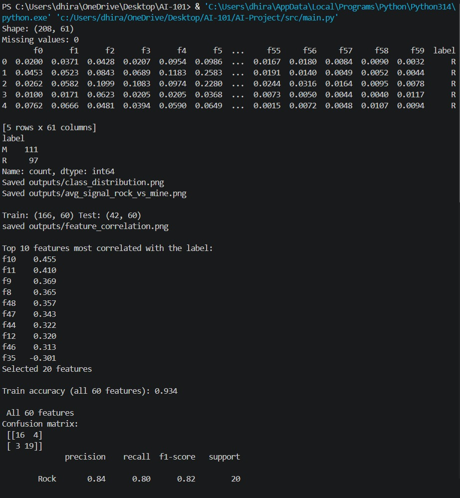
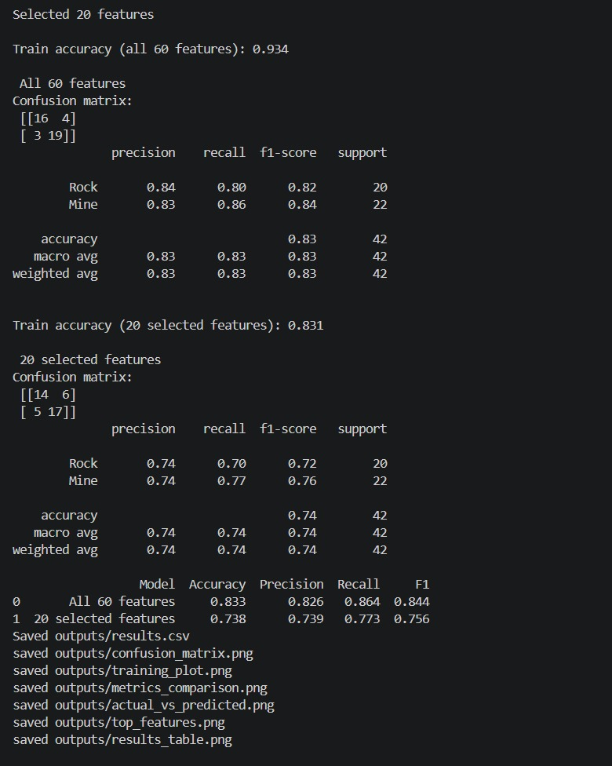
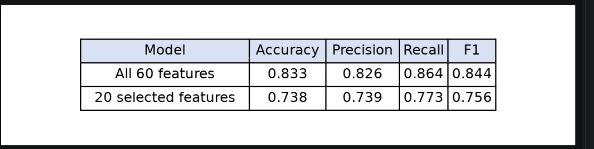

# Sonar: Mines vs Rocks Classifier

Classifies sonar signals as **Rock (R)** or **Mine (M)** using Logistic Regression.

`AI101 Mini-Project` · `Team 55`

## Team and roles

| Member | Entry no. | Role |
|--------|-----------|------|
| Rishabh Mahar | 2026eeb1399 | PPT lead |
| Dhiraj Kumar Yadav | 2026mcb1525 | Execution lead |
| Arnav Yadav | 2026eeb1326 | Documentation lead |
| Kashish Chhabra | 2026aib1048 | Video lead |

## Project structure
```
AI-Project/
├── data/sonar.csv
├── src/
│   ├── main.py
├── requirements.txt
└── README.md
```
## Dataset

UCI Connectionist Bench (Sonar, Mines vs. Rocks):
https://archive.ics.uci.edu/dataset/151/connectionist+bench+sonar+mines+vs+rocks
The file `data/sonar.csv` is already included in this repo (original file `sonar.all-data`, renamed, no header row).

## Setup

Tested on Python 3.10 / 3.11 (Windows / macOS / Ubuntu).
Enter the below commands one by one
```
git clone https://github.com/arnav-7003/AI-Project.git
cd AI-Project
pip install -r requirements.txt
```

## How to run

1. `python src/main.py`
2. The script prints metrics and saves 4 files in `outputs/`.
3. Expected runtime: under 1 minute.


## Expected output





## Results



## Links

Video - https://youtu.be/NlTKFqgT7nQ

PPT - https://github.com/arnav-7003/AI-Project/blob/main/Project%20Presentation%20Team%2055.pptx

## AI-use disclosure

